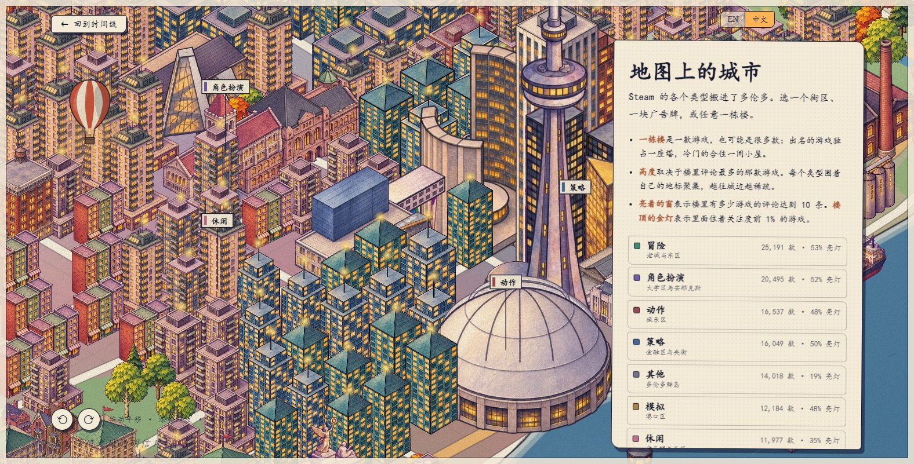
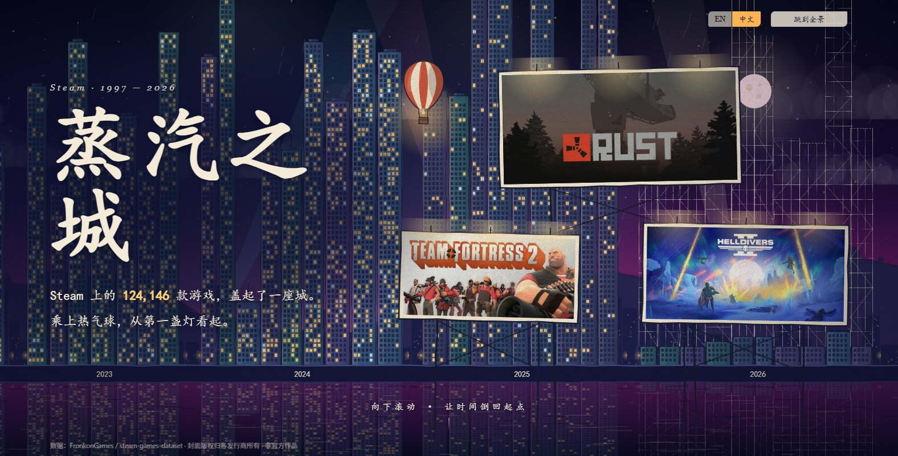
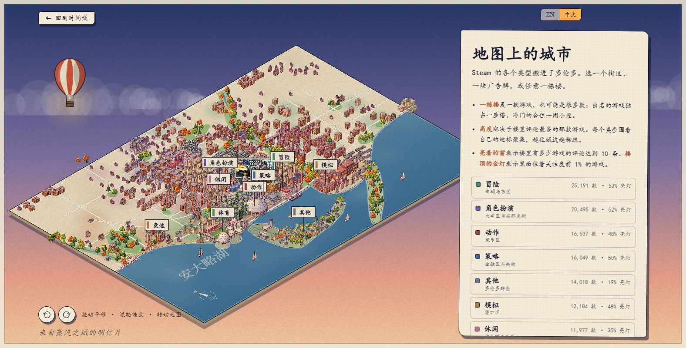
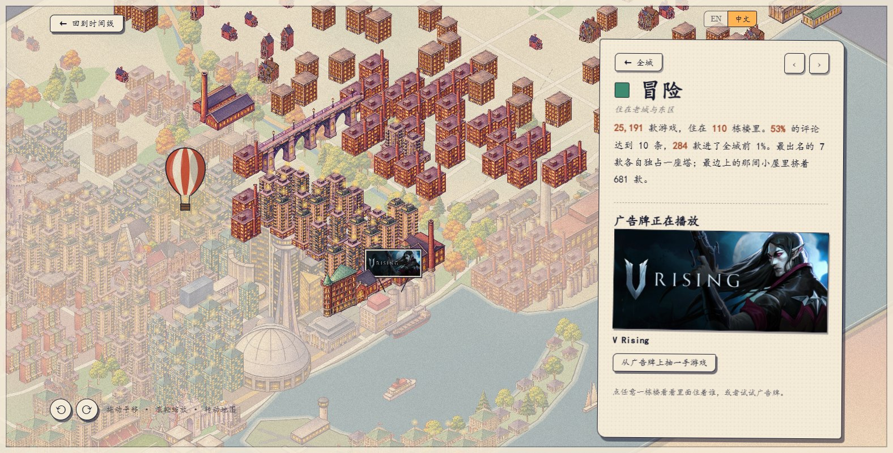

# City of Steam · 蒸汽之城

*An interactive, hand-drawn city built from 124,146 Steam games. Desktop browsers only. English by default, Chinese available.*

把 Steam 上的 124,146 款游戏画成一座城市。数据来自 [FronkonGames/steam-games-dataset](https://huggingface.co/datasets/FronkonGames/steam-games-dataset)。



## 这是什么

网站分两部分：

1. **时间线（开场）**：向下滚动，热气球带你从 1997 年飞到 2026 年，城市一年一年盖起来。
2. **多伦多地图（探索）**：整座城市变成一张可以转动的多伦多地图，每个街区是一种游戏类型，可以点进去找游戏。

| 时间线 | 整张地图 | 一个街区 |
| --- | --- | --- |
|  |  |  |

## 怎么读这座城市

| 你看到的 | 它代表的 |
| --- | --- |
| 一扇窗 | 10 款游戏 |
| 亮灯的窗 | 至少有 10 条评论的游戏 |
| 金色的窗 | 评论数排前 1% 的游戏（1,241 款，拿走了全部评论的 80%） |
| 一年的楼群 | 那一年发售的全部游戏 |
| 2026 年的脚手架 | 按前几个月的发售量推算的全年规模 |
| 地图上的一个街区 | 一种游戏类型 |
| 地图上的一栋楼 | 一款或多款游戏：越有名的游戏越靠近中心，独占一栋高楼；边缘的小房子里住着几百款 |
| 广告牌 | 轮流播放该街区的游戏，越有名出现得越多；点一下会发给你一组游戏供选择 |

街区和类型的对应：

| 类型 | 街区 |
| --- | --- |
| 动作 Action | 娱乐区 Entertainment District |
| 策略 Strategy | 金融区 Financial District |
| 角色扮演 RPG | 大学区 University & Annex |
| 休闲 Casual | 肯辛顿 Kensington & West End |
| 冒险 Adventure | 老城 Old Town & East End |
| 模拟 Simulation | 港口区 Port Lands |
| 体育 Sports | 展览广场 Exhibition Place |
| 竞速 Racing | 湖滨西 Lake Shore West |
| 其他 Other | 多伦多群岛 Toronto Islands |

## 运行

不需要安装任何东西，只要有 Python：

```bash
python -m http.server 8765 --directory site
```

macOS 和 Linux 上把 `python` 换成 `python3`。然后用桌面浏览器打开 <http://localhost:8765>。

改了代码却看不到变化时，按 Ctrl+Shift+R 强制刷新。

## 怎么操作

- **时间线**：滚动鼠标前进；右上角切换 EN / 中文；可以搜索一款游戏找到它的那扇窗；可以只看金色的 1%。
- **进入地图**：滚到全景后点 “走进街区”。
- **地图**：拖动平移，滚轮缩放，`Q` / `E` 或圆形按钮转动视角（每次转 90°，共四个朝向）；点街区、广告牌或楼房查看里面的游戏，点游戏打开详情卡片。

## 目录

```
site/            网站本体（纯静态，没有构建步骤，没有第三方库）
  index.html     入口
  js/city.js       第一部分：时间线
  js/districts.js  第二部分：多伦多地图
  js/toronto.js    多伦多的地理：湖岸、河、道路、地标位置、街区
  js/models.js     代码绘制的建筑组件（36 个地标、13 类普通建筑），现在是后备和灰模参考
  js/sprites.js    加载手绘素材，替换上面的组件
  js/draw.js       两部分共用的手绘函数和中英文文案
  data/            预处理好的数据
  sprites/         地图用的手绘素材（由 scripts/artkit_sprites.py 生成）
  models.html      所有建筑组件的总览页
  wall.html        早期的封面墙版本，留作参考
scripts/         数据处理和素材包脚本
artkit/          手绘素材包：给 ChatGPT 的提示词、参考图、接入记录
output/          ChatGPT 画好的原图（不在仓库里，从 Releases 下载）
docs/screenshots/  本页用的效果图
```

## 数据文件

| 文件 | 内容 |
| --- | --- |
| `site/data/cols.bin` + `meta.json` | 每款游戏的数值列：发售时间、评论数、价格、好评率、类型、封面主色等 |
| `site/data/names.json` | 游戏名和封面地址 |
| `site/data/city.json` | 每年的统计和 2026 年的推算 |
| `site/data/diorama.json` | 每个类型最有名的游戏 |
| `site/data/lod*.webp` | 封面缩略图拼图（只有 `wall.html` 用） |

封面大图直接从 Steam 的 CDN 加载，所以看封面需要联网。

## 重新生成数据

数据已经在仓库里，一般不需要重做。要重做的话：

```bash
pip install pandas pyarrow pillow numpy requests
```

```bash
mkdir -p data_raw work
```

```bash
curl -L -o data_raw/games.parquet https://huggingface.co/datasets/FronkonGames/steam-games-dataset/resolve/main/data/train-00000-of-00001.parquet
```

```bash
python scripts/fetch_thumbs.py data_raw/games.parquet work
```

```bash
python scripts/build_data.py data_raw/games.parquet work site/data
```

```bash
python scripts/build_city.py data_raw/games.parquet site/data/city.json
```

```bash
python scripts/build_diorama.py data_raw/games.parquet site/data/diorama.json
```

`fetch_thumbs.py` 会下载全部游戏封面，大约需要 6 分钟。

## 手绘素材包

地图上的建筑、船和树用的是 ChatGPT 生成的手绘图：每个组件一张图，图里是同一栋建筑的四个朝向。64 个组件都已接入；没有手绘图的组件会自动退回代码绘制的版本。

- 操作说明和全部提示词在 [`artkit/PROMPTS.md`](artkit/PROMPTS.md)。
- `artkit/batch-01` 到 `batch-08` 是 64 个组件的灰模参考图，每批 8 张。
- ChatGPT 画好的原图放在 `output/batch-01` 到 `batch-08`，文件名是 `组件名.png`。原图共 56 MB，不在仓库里，需要时从 [Releases 下载 `artkit-output.zip`](https://github.com/summer2048/steam-city-viz/releases/download/artkit-raw-v1/artkit-output.zip)，解压到项目根目录。只运行网站不需要它，`site/sprites/` 里已经有处理好的素材。
- 接入方式、取舍和开发记录在 [`artkit/INTEGRATION.md`](artkit/INTEGRATION.md)。

换了或重画了原图之后，重新生成地图用的素材（需要 `pillow` 和 `numpy`，大约三分钟）：

```bash
python scripts/artkit_sprites.py
```

打开 <http://localhost:8765/models.html> 可以看到全部手绘素材。在地址后面加 `?noart`（例如 `http://localhost:8765/?noart#map`）可以切回代码绘制的版本做对比；`#map` 会跳过时间线直接进入地图。

## 统计口径

- **类型**：一款游戏有多个类型时，归入其中最少见的那个主类型（竞速 < 体育 < 角色扮演 < 策略 < 模拟 < 冒险 < 动作 < 休闲），都不属于则归 “其他”。
- **评论数**：好评数加差评数，用来衡量一款游戏有多少人关注。
- 81 款游戏没有封面地址，用深灰色占位。

## 说明

非官方作品。游戏封面版权归各发行商所有。
